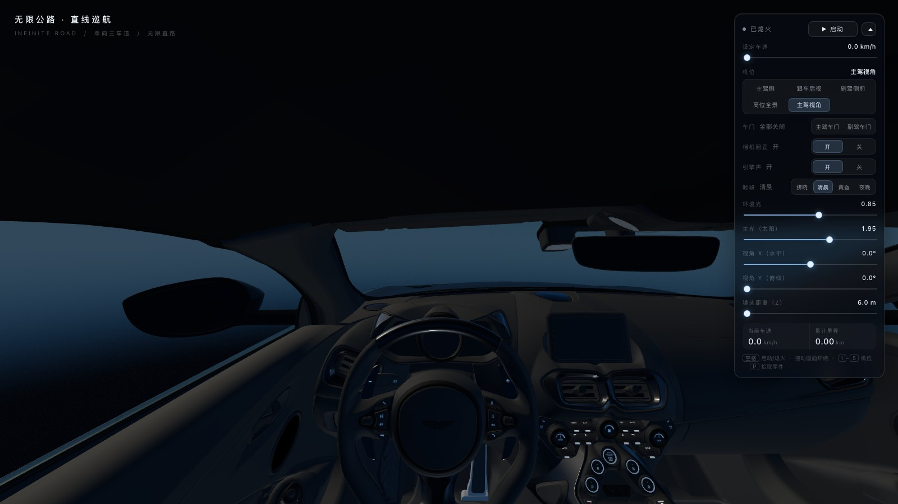
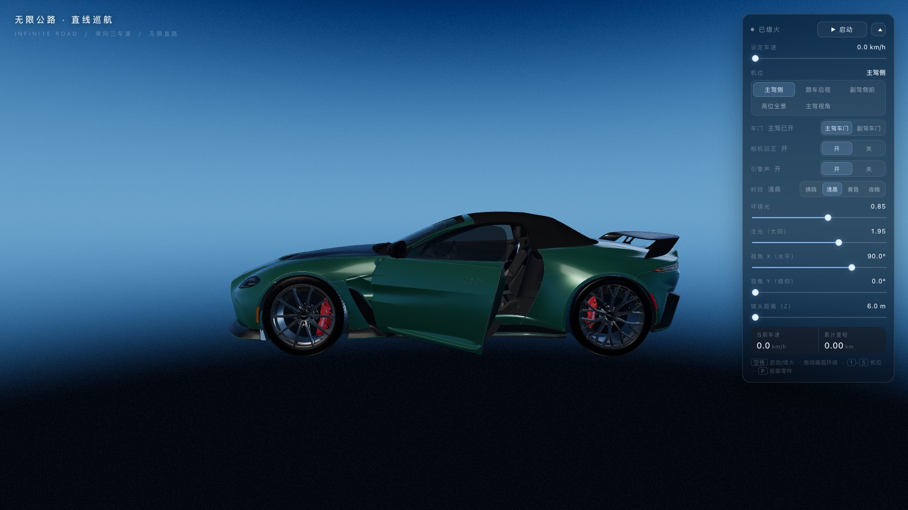
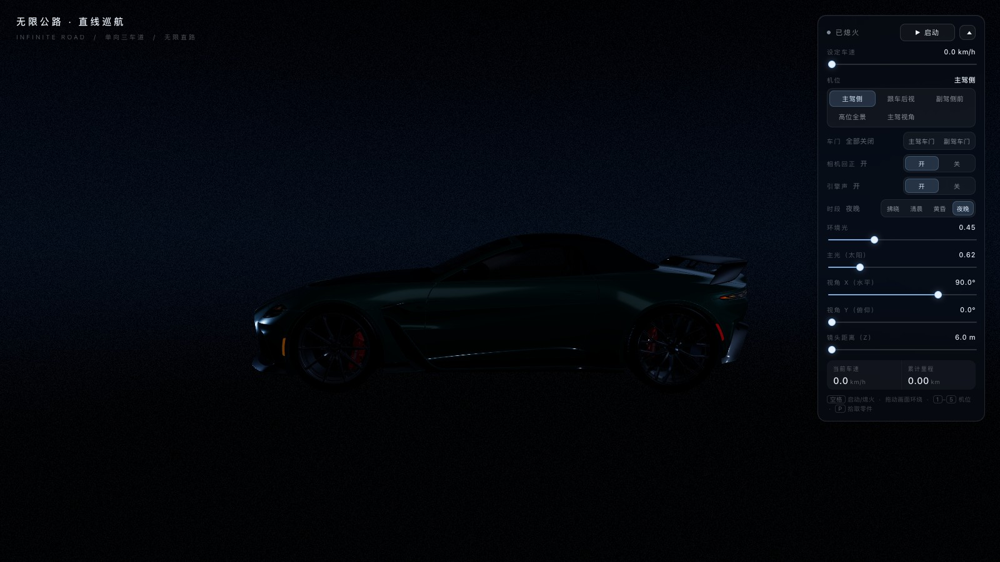

# 无限公路 · 直线巡航

一个用 three.js 手写的「无限直路」跟车 / 环视 Web 演示：没有赛道、没有道路网格、也**没有天空穹顶**（背景是纯色），车永远停在原点跑，世界靠车辆模型 + 里程表 + 粒子特效营造出一直向前的错觉。

**在线体验：<https://littleboyck.github.io/infinite-road/>**


> 纯静态站点，零构建、零依赖安装（three.js 已内联在 `vendor/`），用任意静态服务器打开即可；GitHub Pages 上直接可跑。

## 目录

- [页面截图](#页面截图)
- [功能一览](#功能一览)
- [快速开始](#快速开始)
- [操作方式](#操作方式)
- [核心参数](#核心参数)
- [实现思路](#实现思路)
- [目录结构](#目录结构)
- [开发与验证](#开发与验证)
- [已知限制](#已知限制)
- [素材与许可](#素材与许可)

## 页面截图

| 默认机位「主驾侧」 | 车内「主驾视角」 |
|---|---|
|  |  |

| 车门开启（主驾侧） | 夜晚时段 |
|---|---|
|  |  |

## 功能一览

- **五个机位**：主驾侧 / 跟车后视 / 副驾侧前 / 高位全景 / 主驾视角（车内），切换时相机沿圆弧绕车过渡，而不是直线穿过车身。
- **可开关的车门**：模型本身是整体焊接网格，没有独立车门节点；程序按「连通块（岛）」把门板、侧窗、门内饰板、后视镜从车身几何里切出来，挂到铰链枢轴上开合。
- **行驶状态机**：默认熄火；点「启动」先原地打火 3.4 s（车轮不转），然后按 4.5 m/s² 线性加速到设定车速，熄火按 10 m/s² 线性减速。
- **引擎声**：WebAudio 播放 Lotus Elise 录音，切出点火段 + 30–40 s 的怠速段做无缝循环，按车速调播放速率与音量；熄火静音。音频的实时 RMS 还会驱动控制台车速滑杆轻微「呼吸」（只影响显示）。
- **像相机操控**：拖动画面环绕 / 车内原地转头；滑杆控制水平角、俯仰角、镜头距离；「相机回正」开关决定松手是否回到默认角度。
- **粒子聚合（`src/particles-reveal.js`）**：**默认开播**（加载淡入后自动开始一轮），车体先被 32 万颗粒子替身接管，粒子从车头向车尾聚合成形、扫光上色，最后凝结回实体车；控制台「粒子聚合 → 停止」可随时打断，「播放」可再放一轮。实现方式见下方「粒子聚合插件」一节。
- **自由视角（OrbitControls）**：控制台「全景查看」或按 <kbd>V</kbd> 打开，相机交给 three.js 的 OrbitControls，按设计插件视口的方式操作 —— 左键环绕、右键平移、滚轮缩放（0.6–2400 m），俯仰 0–180° 不设限；再点一次或切任意机位即交还给车载机位（带一小段回落过渡）。
- **零件拾取调试**：按 <kbd>P</kbd> 后点击车辆，浮层显示零件名、车辆本地坐标、所属岛包围盒，并给选中的岛叠一层青绿色高亮 —— 车门归属就是这样一点点对出来的。
- **地面**：场景里没有实体地面，车下一直是一层**粒子地面**（半径 9 m 的圆盘，20 万颗粒子，按 `sqrt` 修正在圆盘内均匀撒点）。它不参与扫光/上色/凝结——车凝聚成实体后，地面仍然保持粒子状态，像 demo 里那样。
- **车影**：地面没有实体，所以用车底两块「只压暗、不画面」的平面来接影：`ShadowCatcher` 是真实太阳投影（`ShadowMaterial`），`ContactShadow` 是贴合车身的软接触阴影（径向渐变贴图）。两者都用 `MultiplyBlending`——白=画面不变、灰=压暗，因此能直接作用在粒子地面上；它们固定在地面 y≈0，强度由一个 `uShadowFade` 统一控制：粒子阶段为 0，凝结开始后随 `dissolveT` **线性**涨到 1，所以影子是慢慢浮现的，不会突然出现。
- **时段预设**：拂晓 / 清晨 / 黄昏 / 夜晚，切换天空三段色、环境光、太阳强度与曝光。

## 快速开始

```bash
# 仓库根目录就是站点根目录
python3 serve.py 8777
# 打开 http://127.0.0.1:8777/
```

`serve.py` 是带 `no-store` 的静态服务器（避免浏览器缓存旧模块）。用任何静态服务器（`npx serve`、nginx、GitHub Pages）都可以，因为全部资源都是相对路径。

## 操作方式

| 输入 | 作用 |
|---|---|
| 拖动画面 | 车外：绕车环绕；车内（主驾视角）：原地转头（不限角度） |
| <kbd>空格</kbd> | 启动 / 熄火 |
| <kbd>1</kbd>–<kbd>5</kbd> | 切换机位（与控制台按钮顺序一致） |
| <kbd>V</kbd> | 开关自由视角（OrbitControls：左键环绕 / 右键平移 / 滚轮缩放，可看整个场景） |
| <kbd>P</kbd> | 开关零件拾取工具（开着时点击不转视角，只拾取） |

控制台右侧面板：

- **设定车速**：巡航目标车速（0–220 km/h）。熄火时滑杆显示 0，启动后回到设定值并随引擎声波轻微律动。
- **机位 / 全景查看（自由视角）/ 车门 / 相机回正 / 引擎声 / 时段**：点选即可。
- **环境光 / 主光 / 视角 X / 视角 Y / 镜头距离**：渲染与相机参数。
- **当前车速 / 累计里程**：实时读数。

## 核心参数

以下常量都在 `src/main.js` 里，改完刷新页面即生效。

### 行驶

| 常量 | 值 | 说明 |
|---|---|---|
| `RUN_ACCEL` | `4.5` m/s² | 线性加速度，0 → 100 km/h 约 6.2 s |
| `RUN_BRAKE` | `10.0` m/s² | 线性减速度，100 km/h → 静止约 2.8 s |
| `STARTUP_CRANK` | `3.4` s | 打火阶段时长，期间车轮与车速保持 0 |
| `state.speedSetKmh` | `100` | 默认巡航车速（滑杆真实值） |
| `WHEEL_RADIUS` | 取自车轮包围盒 | 滚动角 ω = v / R |

### 机位

| # | 名称 | `pos` (x, y, z) | `look` (x, y, z) | 默认 yaw | fov | 备注 |
|---|---|---|---|---|---|---|
| 0 | 主驾侧 | `0, 1.30, 5.2` | `0, 0.82, 0` | 90° | 55 | 默认机位 |
| 1 | 跟车后视 | `0, 2.55, -6.0` | `0, 0.70, 0` | 0° | 50 | 向上拖可降到约 1.2 m |
| 2 | 副驾侧前 | `0.85, 1.12, 6.6` | `-0.35, 0.66, 0.2` | -45° | 40 | 斜前方 3/4 |
| 3 | 高位全景 | `-2.6, 6.0, -11.6` | `0, 0.70, 0` | 0° | 50 | |
| 4 | 主驾视角 | `-0.36, 1.15, -0.62` | `-0.36, 0.78, 8.0` | 0° | 76 | `lookAround: true` |

坐标都在「车辆本地坐标系」里：**+X = 车身左侧（主驾）**，**+Y = 上**，**+Z = 车头**。

### 相机

| 常量 | 值 | 说明 |
|---|---|---|
| `PITCH_MAX` | 30° | 俯仰滑杆上限（也是拖动的上限） |
| `PITCH_SENS` | `0.0016` rad/px | 拖动俯仰灵敏度 |
| `ORBIT_SENS` | `0.0035` rad/px | 拖动水平灵敏度 |
| `POLAR_MIN / POLAR_MAX` | `10° / 170°` | 球坐标极角限制 |
| `CAM_MIN_HEIGHT` | `0.55` m | 相机离地最低高度 |
| `CAM_DIST_MIN / MAX / DEFAULT` | `6 / 12 / 6` m | 「镜头距离（Z）」滑杆范围 |
| `camTween.dur` | `0.85` | 机位切换圆弧过渡时长（s） |

### 车门

| 常量 | 值 | 说明 |
|---|---|---|
| `DOOR_HINGE_X` | `0.80` m | 铰链轴 x（门与车身接缝，靠外板） |
| `DOOR_HINGE_Z` | `0.74` m | 铰链轴 z（车门前沿接缝） |
| `DOOR_OPEN_DEG` | `45°` | 全开角度（更大时门内饰板会挡住座舱视线） |
| `DOOR_REGION` | `x 0.55–1.20`、`y 0.10–1.35`、`z -0.95–0.92` | 左门箱体；右侧镜像 |
| 门件白名单 | `Paint`、`Window_Geo_lodA(_3)`、`GlassInside`、`Carbon1`、`Interior_Geo_lodA001(_1/_2)`、`Grille2`、`Coloured`、`Base` | 只有这些网格里的岛可能归门 |

### 引擎声

| 常量 | 值 | 说明 |
|---|---|---|
| `ENGINE_URL` | `./assets/audio/lotus_elise_start_rev_idle_preview.mp3` | Freesound CC0 录音 |
| `ENGINE_IGNITION_LEN` | `3.4` s | 点火段（0–3.4 s，播放一次） |
| `ENGINE_IDLE_START` | `30.0` s | 循环起点（稳定怠速段） |
| `ENGINE_IDLE_LEN` | `10.0` s | 循环长度（30–40 s） |
| `ENGINE_CROSSFADE` | `0.08` s | 循环接缝等功率交叉淡化 |
| 播放速率 | `0.94 + k * 0.42` | `k = min(v / 30, 1)`，随车速升音高 |
| 循环音量 | `0.34 + k * 0.42` | 熄火/暂停为 0 |
| 滑杆律动 | `speedWaveLevel * 14` km/h | 由 `AnalyserNode` 的实时 RMS 驱动（仅显示） |

### 时段预设（`PRESETS`）

| 时段 | 天空 top / horizon | 曝光 | 环境光 | 太阳 |
|---|---|---|---|---|
| 拂晓 dawn | `0x0a2444 / 0x9d6a5e` | 1.05 | 0.55 | 1.10 |
| 清晨 morning（默认） | `0x0b2c58 / 0x5a92c8` | 1.00 | 0.85 | 1.95 |
| 黄昏 dusk | `0x110f24 / 0xc27a4c` | 0.95 | 0.60 | 1.50 |
| 夜晚 night | `0x050910 / 0x101a26` | 1.30 | 0.22 | 0.30 |

## 实现思路

### 1. 为什么是「直线 + 纯色背景」

最早版本是一条 2.1 km 的闭环高架（`track.json` + 桥梁模型），后来改成「无限直路」：车身固定在原点，只让里程表和远处景物变化。最终连路面也删掉了，画面只剩**车辆 + 灯光 + 纯色背景**（天空穹顶后来也移除，车漆反射仍来自 PMREM 环境贴图），因此不需要任何道路几何 —— 车看起来永远在往前开。

### 2. 相机：机位描述 + 半径/方位角插值

每个机位只是一组 `pos / look / yaw / fov`。装配时把偏移换成「半径 r、方位角 a、高度 h」，切换机位时三者线性插值、方位角走最近等价角 —— 相机于是沿**以车为圆心的圆弧**扫过去：

```js
function rigPolar(ox, oz) {
  // 装配时世界偏移是 (-ox, oy, oz)，所以方位角要按 atan2(-ox, oz) 取
  return { r: Math.hypot(ox, oz), a: Math.atan2(-ox, oz) };
}

// updateCameraRig() 里：
if (camTween.active && !snap) {
  camTween.t = Math.min(camTween.t + (dt || 0.016) / camTween.dur, 1);
  const e = camTween.t * camTween.t * (3 - 2 * camTween.t);   // smoothstep
  const r = camTween.r0 + (camTween.r1 - camTween.r0) * e;
  const a = camTween.a0 + camTween.da * e;                    // 最近等价角
  const h = camTween.h0 + (camTween.h1 - camTween.h0) * e;
  rig.ox = -r * Math.sin(a);
  rig.oz =  r * Math.cos(a);
  rig.oy =  h;
}
```

车内机位加了 `lookAround: true`：相机位置固定，拖动只旋转「看向方向」（像扭头），因此不会转到座椅或车顶上去。

「镜头距离（Z）」对所有车外机位生效 —— 按偏移方向等比缩放半径：

```js
function camDistOffset(px, pz) {
  const d = state.camDist - CAM_DIST_DEFAULT;
  const r = Math.hypot(px, pz);
  const k = Math.max(1.0, r + d) / r;
  return [px * k, pz * k];
}
```

### 3. 车门：从整体网格里按「连通块」切出来

`car.glb` 没有车门节点，门只是 `Paint` / `Interior_*` 这些大网格里的一块块独立曲面（岛）。做法：

1. 对每个网格做**并查集**求连通块（按三角形共享顶点）；
2. 每个岛算包围盒，判断是否整体落在车门箱体 `DOOR_REGION` 内；
3. 命中的三角形拷成新几何挂到 `DoorPivotL/R` 枢轴（几何先平移到枢轴局部系），车身只保留剩余三角形；
4. 枢轴放在门与车身的**前缘接缝**上，`rotation.y = ∓45°` 开合。

判定里踩过的两个坑（都写进注释了）：

```js
// 左右门在 x 上是镜像的：必须用「离车身中轴最近的那一面」判断，
// 否则右门（x 全为负）会一直被当成「偏内」而整块丢掉
const innerX = Math.min(Math.abs(box.min.x), Math.abs(box.max.x));
if (/^Interior/.test(meshName) && innerX < 0.62) return false;
```

```js
// 切分/复制几何时要把「归一化整型」顶点属性还原成 0..1 浮点，
// 否则顶点色会被当成 0..255 直接把门板点亮成一片惨白
if (attr.normalized && !(src instanceof Float32Array)) {
  if (src instanceof Uint8Array) scale = 1 / 255;
  else if (src instanceof Int8Array) scale = 1 / 127;
  else if (src instanceof Uint16Array) scale = 1 / 65535;
  else if (src instanceof Int16Array) scale = 1 / 32767;
}
```

### 4. 行驶状态机

```
熄火 ──点启动──▶ 打火(3.4 s，车轮不动) ──▶ 运行(线性加速到设定车速) ──点熄火──▶ 熄火(线性减速到 0)
```

每帧只有一段线性积分，简单但手感可预期：

```js
if (state.startupLeft > 0) state.startupLeft = Math.max(0, state.startupLeft - dt);
const cranking = state.startupLeft > 0;
const vTarget = state.playing && !cranking ? state.speedTarget : 0;
const vRate = state.playing && !cranking ? RUN_ACCEL : RUN_BRAKE;
const vStep = vRate * dt;
state.speedNow = Math.abs(vTarget - state.speedNow) <= vStep
  ? vTarget
  : state.speedNow + Math.sign(vTarget - state.speedNow) * vStep;
```

车轮滚动角直接用 `speedNow`，所以打火、熄火时轮子自然停住；「主驾视角」机位还能联动一次开/关车门（开门 → 移机位 → 关门）。

### 5. 引擎声：从一段录音里切出「点火」和「无缝怠速循环」

先用 20 ms 分窗算出 RMS 包络，找出「起伏段（点火 + 原地轰油）」和「平坦段（稳定怠速）」的分界（27 s），再手调常量取 0–3.4 s 作点火、30–40 s 作循环。循环接缝用等功率交叉淡化抹平：

```js
for (let i = 0; i < xf; i++) {
  const t = i / xf;
  const a = Math.cos(t * Math.PI * 0.5);   // 尾部权重
  const b = Math.sin(t * Math.PI * 0.5);   // 头部权重
  dst[len - xf + i] = dst[len - xf + i] * a + dst[i] * b;
}
```

包络图和这套流程的可视化说明在 `sfx-envelope.html`、`archify/sfx-envelope.html`。

### 6. 拾取工具（调试用）

按 <kbd>P</kbd> 打开后点击车辆：`Raycaster` 命中三角形 → 反查该三角形所属的岛 → 把整个岛按 `mesh.matrixWorld` 抽出来叠一层半透明高亮，同时在浮层打印零件名、车辆本地坐标、岛包围盒。车门零件的归属就是靠它逐个确认的。

## 目录结构

```
viaduct_web/
├── index.html              # 页面结构 + 全部 UI 样式（控制台、HUD、加载遮罩）
├── serve.py                # 开发用静态服务器（no-store）
├── src/
│   ├── main.js             # 主逻辑：渲染、车辆、相机、车门、行驶状态、引擎声、拾取工具
│   ├── sky.js              # 天空着色器 + 环境光照贴图（穹顶网格已不加入场景）
│   ├── particles-reveal.js # 粒子聚合 → 上色 → 凝结插件
│   └── track.js            # 早期闭环轨道的采样实现（当前版本未使用，保留参考）
├── assets/
│   ├── car.glb             # 车辆模型（15 MB）
│   ├── track.json          # 早期环形轨迹数据（当前未使用）
│   └── audio/              # 引擎声（Freesound CC0）
├── vendor/                 # three.js / GLTFLoader / OrbitControls（本地内联，离线可用）
├── utils/                  # BufferGeometryUtils
├── screenshots/            # README 使用的截图
├── sfx-envelope.html       # 音频包络分析图（可交互）
└── archify/                # 音频分段流程图（Archify 产物）
```

## 粒子聚合插件

`src/particles-reveal.js` 由 `demo/particles.js` 抽出，是一个与页面无关的 three.js 插件：不建 renderer / scene / camera，也不接管 rAF 和 DOM，挂到已有场景上由调用方每帧驱动。

```js
import { createParticleReveal } from './particles-reveal.js';

const reveal = createParticleReveal({
  scene, camera, renderer,
  car: state.car,        // 播的时候整体隐藏，因此不要传单个 Mesh
  carCount: 320000,
  groundCount: 200000,   // 地面粒子（圆盘随机撒点，半径 9 m；不参与凝结）
  groundRadius: 9,
  loop: false,
  blending: 'additive',  // 'normal' 可保留车漆本色
  onPhase: (name) => {}, // aggregate / paint / dissolve / done
  onFinish: () => {},
});

reveal.prewarm(renderer, scene, camera); // 可选：先跑一遍凝结用的着色器/贴图（放在加载遮罩后面）
reveal.play();           // 播一轮（首次调用才真正 build，约 250 ms）
reveal.update();         // 每帧调用，内部读 performance.now()
reveal.stop();           // 立即恢复实体车
reveal.dispose();        // 释放几何体与材质
```

时间线：0–5 s 聚合 → 5–7.6 s 扫光上色 → 2 s 后开始 5 s 凝结（实体按噪声 discard 长出来，粒子同步消失）。凝结出来的实体一开始是**半透明**的（`uAlpha` 从 0.18 线性涨到 1，材质临时切到透明通道；注意 `depthWrite` 保持 `true`，否则地面那两块 `MultiplyBlending` 阴影平面会盖到车身上把它压暗，到切回不透明时会「突然变亮」），像显影一样慢慢变成不透明的车漆本色——全程不混白，颜色一直是车漆色。所有时长、粒子数、尺寸都可通过参数覆盖，详见 `DEFAULTS`。

`prewarm()` 的作用：凝结开始那一帧才第一次绘制车体，着色器编译 + 贴图上传会让帧时间从 16 ms 涨到 200 ms 以上（肉眼就是「卡一下」）。它把 `uDissolve` 设为 0（所有片元 discard，画不出内容）后临时让车体显形渲染一帧，把这个开销提前到加载过程中，正式凝结时只剩改 uniform 和翻 `visible`。

## 开发与验证

```bash
# 语法检查（main.js 是 ES module，复制成 .mjs 再 check）
cp src/main.js /tmp/main.mjs && node --check /tmp/main.mjs

# 起服务
python3 serve.py 8777
```

页面里暴露了调试接口，方便自动化回归：

```js
window.__viaduct.getSnapshot()   // { ready, camMode, camPos, orbitYaw, drawCalls, triangles, errors, ... }
window.__viaduct.setCamMode(i)
window.__viaduct.applyPreset('morning' | 'dawn' | 'dusk' | 'night')
window.__viaduct.setPlaying(true | false)
window.__viaduct.camModes        // 机位表（可在控制台临时改，刷新即复原）
```

## 已知限制

- 车辆模型是整体网格，车门只能按「岛」整块切；跨门缝的零件只能整块归给某一侧，做不到逐三角形细分。
- 引擎声是采样循环 + 变速，没有做 3D 空间化（无多普勒、不随镜头距离衰减）。
- 熄火状态下仍可预设车速，但此时车速滑杆显示 0（启动后才落到设定值并随声波律动）。
- 画面里没有路面几何，也不再有天空穹顶：背景是纯色 `#0a111a`，氛围靠车漆反射与灯光；视角压得很低时只有底色。

## 素材与许可

- **three.js**：MIT，`vendor/` 内为本地副本。
- **车辆模型** `assets/car.glb`：由项目作者提供，仅用于本演示。
- **引擎录音**：Freesound 上 [victormalloy — Lotus Elise start rev idle](https://freesound.org/people/victormalloy/sounds/113205/)（CC0，可商用免署名），本仓库使用其公开 HQ 预览 mp3 的切片。
- 代码部分可自由参考使用。
